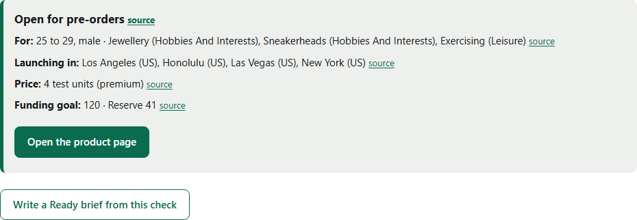
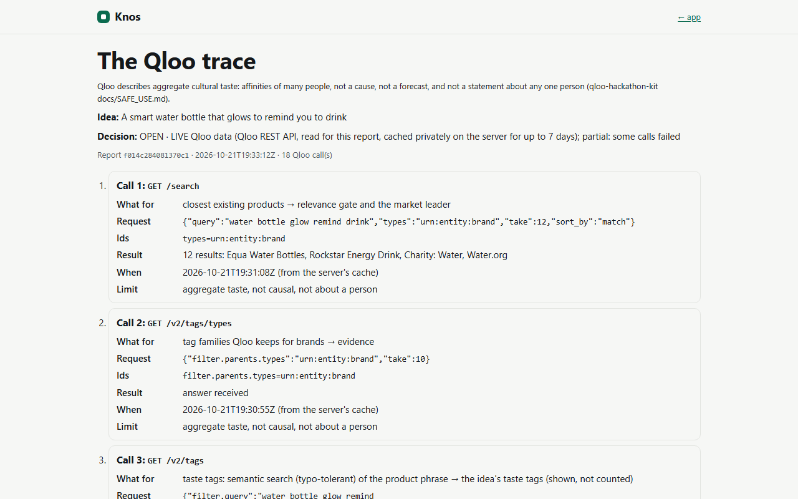
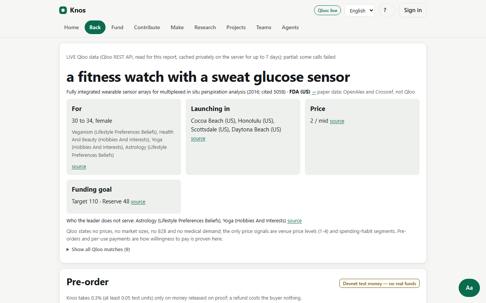
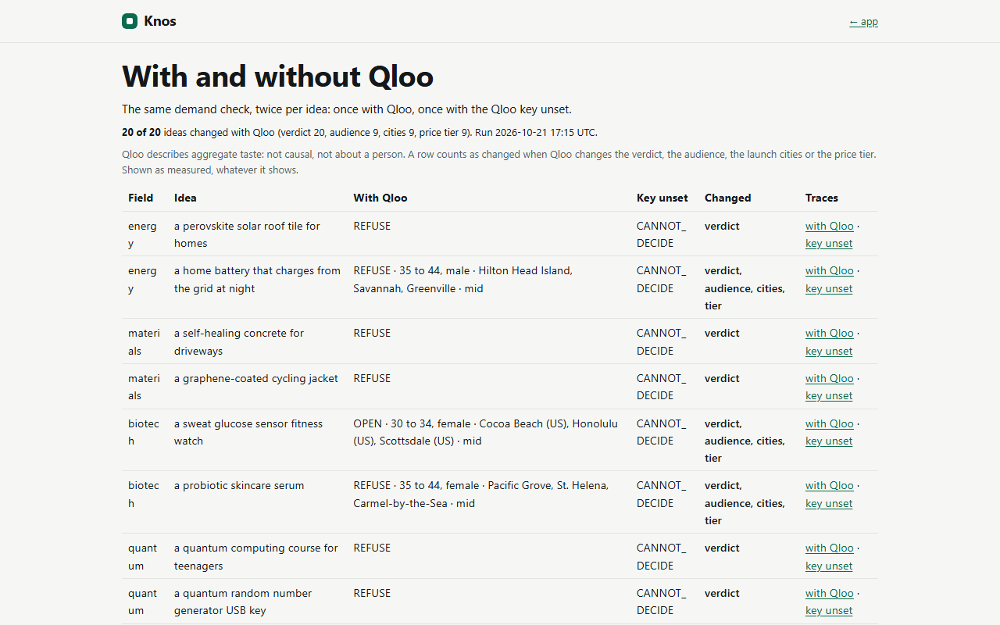

# Knos: research across the valley of death, with Qloo at the demand wall

**Live:** [knos.onrender.com](https://knos.onrender.com/) (the app) · [drexthealpha.github.io/Knos](https://drexthealpha.github.io/Knos/#demand) (the front door's demand check) · no sign-up to check demand.
**Code:** this repository, MIT licence. **Status:** Solana devnet, test money, no customers yet.

The six parts below follow the [Qloo hackathon kit's submission guide](https://github.com/qloo/qloo-hackathon-kit/blob/main/docs/SUBMISSION.md).
The Devpost text is at [docs/submission/DEVPOST.md](docs/submission/DEVPOST.md); every change since 30 September is in [docs/submission/UPDATES.md](docs/submission/UPDATES.md).

## 1. The problem

Most research that works never becomes a product: a paper proves a result, and then nobody can tell who would buy it,
where, or at what price, so no one funds the next step. That gap between a result and a product is the "valley of
death". Knos is an agent that carries a paper or an idea across it: a demand check, a brief clear enough to fund,
milestones held in escrow on Solana, and payment only on verified proof.

Qloo is load-bearing at the first step, the demand wall. Before any money moves, Qloo's taste data decides who wants
the product, where to launch it, at what price tier, and whether pre-orders open at all.

## 2. Qloo tools, and why they fit

| Question Knos must answer | Qloo surface | Why this one |
|---|---|---|
| What already exists like this idea? | `GET /search` (brands, places, media), word-pair retries | Names the market leader and the closest products, by Qloo's own entities |
| Which taste does the idea belong to? | `GET /v2/tags`, `/v2/tags/types` (semantic, typo-tolerant) | Turns the product phrase into Qloo tags that steer the later calls |
| Who wants it? | `/v2/insights` `urn:demographics`, `urn:audience`, `/v2/audiences` | Age and gender affinity and the audience segments, aggregate only |
| Where to launch? | `/v2/insights` `urn:entity:destination` (explainability), `urn:entity:place`, `urn:heatmap` | Launch cities ranked by affinity, with the entities that explain each |
| At what price tier? | `urn:entity:place` price levels and spending-habit segments | The only price signals Qloo has; Knos says so |
| Is there room beside the leader? | `/v2/analysis/compare`, `/v2/trending`, `filter.results.entities` | Overlap with the leader, its trend, and the products ranked against this taste |
| The agent's own reasoning tools | `@qloo/qloo-harness` (`qloo mcp`): the crossing agent's `qloo_*` tools | The agent reads a paper and asks Qloo as an MCP client |

Every family of options (who, gaps, where, price, who serves it, media kind, look-up) is a control in the app, a typed
argument of the hosted `/mcp` tools, a field of the API and a flag of `knos demand`: [docs/reference/QLOO-COVERAGE.md](docs/reference/QLOO-COVERAGE.md)
marks each documented parameter, type and endpoint as used and where.

## 3. Request to result (redacted)

One idea, as asked live ("a smart water bottle that glows to remind you to drink"). Its full trace, every call with its
parameters and result excerpt, is at [/trace.html?hash=84382fbc…](https://knos.onrender.com/trace.html?hash=84382fbcc7ea2f1def7e94f33389559627404db1a2b50a2f49b2cf351b209a2f).
No key appears in it (it is a request header) and no personal data is sent.

1. `GET /search {"query": "water bottle glow remind drink", "types": "urn:entity:brand", "take": 12, "sort_by": "match"}`
   → 12 brands. Entity choice: Knos keeps only results that share the idea's content words (bottle, water); the
   others are listed as "left out" with the reason. The leader chosen this way: Equa Water Bottles.
2. `GET /v2/tags {"filter.query": "water bottle glow remind drink", "feature.semantic_search": "true", "filter.parents.types": "urn:entity:brand", "take": 8}`
   → taste tags. Tag choice: a tag is kept only when it shares a word with the idea; the rest are shown, not counted.
3. `GET /v2/insights {"filter.type": "urn:demographics", "signal.interests.entities": "<the 3 kept entity ids>"}` → who: 25 to 29, male.
4. `GET /v2/insights {"filter.type": "urn:audience", "take": 20, "signal.interests.entities": "<ids>"}` → segments ranked by affinity.
5. `GET /v2/insights {"filter.type": "urn:entity:destination", "feature.explainability": "true", "filter.geocode.country_code": "US", ...}` → launch cities: Los Angeles, Honolulu, Las Vegas.
6. The rest (places, persona tags, the leader comparison, trends) as listed in the trace.

Knos's own rules (`check.RULES`, [DEMAND_CHECK.md](docs/reference/DEMAND_CHECK.md)) then decide, with no language
model: OPEN, a premium tier, a target and a reserve. The reasons are shown with the verdict, apart from Qloo's answers.
Every Qloo-derived value on the pages links to the call it came from.

What Qloo changes, measured: 20 ideas from 10 fields, each with Qloo and with the key unset, are on
[With and without Qloo](https://knos.onrender.com/with-without). With the key unset Knos cannot decide anything; with
Qloo it decided all 20, and set the audience, cities and price tier in 9 of them.

## 4. Screenshots

No credential or personal data in any of them (taken signed out, with Playwright, from the live app).

| | |
|---|---|
|  |  |
|  |  |

## 5. Setup, from a clean environment

These steps run as written in a fresh `python:3.12` container: the `fresh setup` workflow (`.github/workflows/fresh-setup.yml`) runs them there on every change to this file, and `scripts/fresh_setup.sh` does the same locally with Docker. Without a
Qloo key every check honestly says it cannot decide; put your own event key in `QLOO_API_KEY` for live answers.

```bash
git clone --depth 1 https://github.com/drexthealpha/Knos.git
cd Knos
python -m pip install --quiet . "./apps/wanted[escrow,auth]"
cd apps/wanted
export QLOO_BASE_URL=https://hackathon.api.qloo.com
python -m knos_wanted serve --host 127.0.0.1 --port 8080 > /tmp/knos.log 2>&1 &
sleep 10
curl -s http://127.0.0.1:8080/healthz
curl -s -X POST http://127.0.0.1:8080/api/check -H "Content-Type: application/json" -d '{"idea": "a smart water bottle that glows to remind you to drink"}' | python -c "import json, sys; r = json.load(sys.stdin); print(r['label'], r['decision']['verdict'])"
```

With a key, open <http://127.0.0.1:8080/#research>, paste a DOI (for example `10.1038/nature16521`) and press
"Run the crossing". The hosted app needs nothing: open the links at the top.

## 6. Limits, and what the results do not establish

- Qloo describes aggregate cultural taste: affinities of many people. A result is not a cause, not a forecast of
  sales, and not a statement about any one person. Knos refuses to ask Qloo to infer anyone's health, finances,
  politics or identity ([How Knos uses Qloo safely](https://knos.onrender.com/qloo-safe-use)).
- Qloo states no prices, no market sizes, no B2B and no medical demand. The only price signals are venue price levels
  (1-4) and spending-habit segments. Pre-orders are how willingness to pay is proven, and there are none from outside
  Knos yet (the live count is on [/invite](https://knos.onrender.com/invite)).
- An OPEN verdict means Qloo's evidence met Knos's published rules for this idea, today. It does not establish that
  the product will sell, and a REFUSE does not establish that it will not: Qloo may simply know too little about a
  new space (it often says so, and Knos shows that reason).
- The matching is lexical: an idea whose words Qloo's catalogue does not use can be refused for that reason alone.
- Money is devnet test money. No customer has paid. One person holds every key.
- The 2.08x fewer reasoning tokens of a Ready brief ([docs/idt](docs/idt/summary.json)) is Knos's own result, from
  clear briefs; it is not Qloo's.
